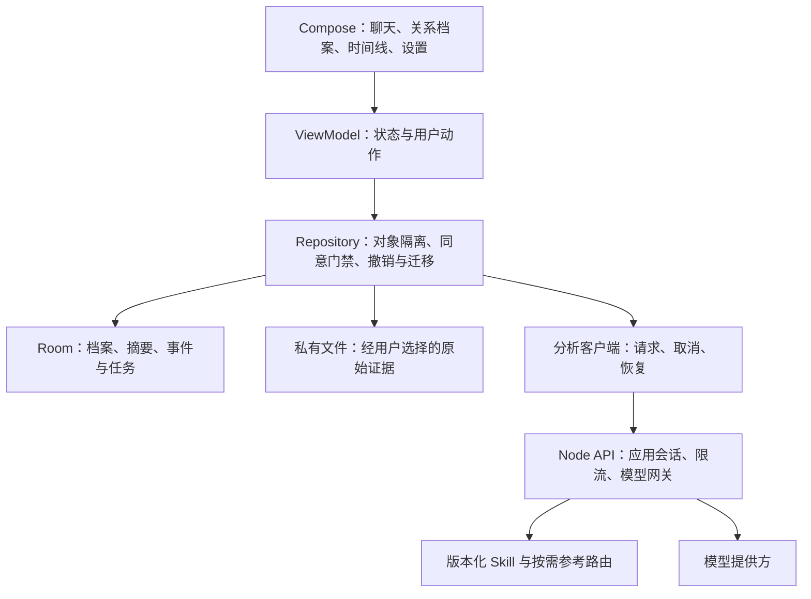

# 狗头军师安卓 App：现状研究与升级路线

研究日期：2026-10-31（用户时区）。用户已确定升级目标为安卓 App。

本文交付代码研究、验证结果和实施建议；目前尚未创建安卓工程、构建 APK 或验证真实模型。建议项不是已实现功能。

## 1. 结论

项目已有可复用的关系分析规则、知识资料、模型网关和领域原型，适合升级为独立安卓应用。主分支只有 Skill；应用实现分散在多个分支。建议采用原生 Kotlin + Jetpack Compose，实现手机端交互与本地数据层，逐项移植已验证的能力。

产品主线建议为「遇到问题 → 获得一句可用回复或明确建议 → 保存必要背景 → 记录行动反馈 → 持续复盘」。保留临时对话入口，首次使用先解决问题，MBTI、评分和完整档案改为按需补充。

## 2. 本地代码与分支地图

研究时使用本机完整 Git 仓库；远端为 `https://github.com/shengjidaguai-china/goutoujunshi.git`，默认分支为 `main`。各分支源代码快照位于本机目录 `D:\图片\文档\ChatGPT\懂你\goutoujunshi-research\`，不带 Git 元数据；完整历史和远端分支保留在研究所用的主仓库中。这些本机研究产物不随开发 worktree 或独立 CI checkout 分发，以下路径仅作来源记录，不作为仓库内可访问链接。

| 代码线 | 固定提交 | 实际内容 | 安卓升级用途 |
| --- | --- | --- | --- |
| `main` | `6db7354a4002dc7c448a9c87ffdad8132570c9d3` | Skill、20 份知识参考、23 份实用参考、Python 记忆脚本、静态验证器 | 业务规则与知识基线 |
| `origin/codex/ui-optimization` | `54a3d0b60696020de6992a63bca2dddd16e0b2cc` | 微信小程序、Node.js API、SQLite、阶跃网关、额度及成本流水 | 参考 API、事务和失败处理设计 |
| `origin/codex/deepseek-harness` | `93c196c40f231cfde7657a27015162ea62fc467f` | React 客户端插件、Harness 工具、对象与证据领域函数、Python 记忆适配 | 参考对象切换、临时对话、证据和归档体验 |
| `origin/feat/goai-boundless-agent` | `d0c7e82ec9f199d28336566da86c9fb2a5ad09f3` | Python 聊天解析、评分、趋势计算和网页 Demo | 参考输入解析及可追溯时间线 |

另发现 `origin/codex/goai-deepseek-harness` 等分支，但未逐一运行。源码快照的引用与提交保存在 本机清单 `D:\图片\文档\ChatGPT\懂你\goutoujunshi-research\snapshot-manifest.json`。

## 3. 实际验证结果

环境中 `python --version` 为 3.13.5，`node --version` 为 22.14.0。

| 验证 | 命令或方式 | 结果及范围 |
| --- | --- | --- |
| 主分支结构与规则检查 | `python scripts/validate_skill.py` | 通过；静态检查 |
| 主分支运行时检查 | `python scripts/validate_skill.py --runtime` | 通过；在完整仓库运行，未另建最小安装包 |
| 小程序与 API 测试 | 在小程序 `server/` 执行 `node --test --test-concurrency=1 tests/*.test.js` | 29/29 通过，包含额度、失败释放、成本和结构测试 |
| Harness 领域与适配器 | 在比赛项目执行 `node --test tests/*.test.mjs` | 首轮 9/10；设置 `PYTHONUTF8=1`、`PYTHONIOENCODING=utf-8` 后 10/10 通过 |
| 关系趋势 Demo | 在 `demo/` 执行 `python -m pytest -q` | 46/46 通过 |
| 记忆边界探针 | 临时目录独立数据库，合成数据 | 复现乱序撤销及无效日期被接受 |
| 网页暂停记忆探针 | 直接调用导出的 `workspaceStore` | 暂停后仍可新增 Demo 记忆 |

未安装完整 Harness 依赖，未启动其网页或执行构建；其要求 Node.js 22.19+，高于本机当前版本。已查看仓库保存的小程序首页和 Harness 手机聊天截图，未作真机交互验证。所有探针使用合成数据和临时数据库，不启用用户的正式长期记忆。

## 4. 需要在迁移前解决的问题

### [必须修复] 指定旧操作撤销会覆盖新状态

[记忆脚本](../scripts/memory_store.py) 的 `command_undo` 按旧操作涉及的记录 ID 删除现状，再恢复旧快照，没有检查后续变更。

复现：同一对象的 `stage` 写入 `v1`，随后改为 `v2`，再撤销第一次写入。结果整个字段消失，后续 `v2` 也丢失。探针结果见 本机探针记录 `D:\图片\文档\ChatGPT\懂你\goutoujunshi-research\memory-probes.json`。

建议：首版仅允许撤销最新操作；如要支持指定操作撤销，增加记录版本、冲突检测和逆向补偿，发现后续修改时返回冲突。

### [必须修复] 网页暂停记忆没有在写入入口生效

Harness 的 `store.js` 中，`toggleMemoryPause` 只修改标志；`addDemoMemory` 与领域 `appendMemory` 未校验该标志。实际调用顺序 `createObject → toggleMemoryPause → addDemoMemory` 后，得到 `memoryPaused=true`、记忆数为 1。

这条结论适用于网页客户端 Demo 路径；Python 记忆脚本的 `apply` 有暂停门禁，二者不能混为同一个存储实现。安卓端应由统一 Repository 在写入事务内检查同意和暂停状态。

### [必须修复] 安卓主聊天需要完整接通真实模型链路

Harness 的客户端 `Composer → workspaceStore.send → nextMessages → analyzeTurn` 路径使用关键词、证据数量及固定话术生成结果，没有在这条路径调用模型网关。Host 另外注册了模型工具，不代表客户端输入框已经接通它们。

建议：定义统一分析接口，明确演示与真实模型状态；完整覆盖等待、取消、超时、失败、重试、流式回复及持久化。小程序阶跃网关可作为参考，需适配安卓登录和 API 契约。

### [建议修改] 档案存储与记忆存在多套实现

主分支是 Python SQLite，Harness 客户端是 `localStorage`，小程序服务端另有 SQLite。不能直接将三套格式视为同步的同一份档案。

建议：定义共同实体、稳定对象 ID、格式版本和迁移策略。安卓档案与摘要采用 Room；敏感正文采用明确的加密方案，密钥由 Android Keystore 保护，备份、导出和删除路径一起设计。Room 本身不提供透明数据库加密。

### [建议修改] 时间字段只校验长度

`validate_delta` 接受 `occurred_at="not-a-date"`，实际写入返回成功。应区分事件时间、导入时间和观察时间，校验 ISO 日期／时间，保留时区与不确定性，支持「时间未知」。

### [建议修改] 现有自检无法证明 AI 回答质量

主分支验证器主要检查文件、文本标记和上下文预算；应用分支测试主要验证规则函数和合成案例。通过这些测试不代表模型不会误判，也不代表长聊天、OCR 或真实接口可用。

建议：补充固定匿名合成评测集，覆盖说话人反转、对象串线、缺失上下文、提示注入、拒绝信号、冲突修复、记忆纠正和不同沟通口吻。把事实引用正确率、关键边界错误数和用户能否执行建议作为指标。

### [问题] 分支许可文本不同

主分支 `LICENSE` 为 MIT；研究的 Harness、趋势 Demo 分支保留 PolyForm Noncommercial 许可文本，Demo 还带第三方声明。未来挑选代码时应逐文件记录来源、提交和许可，不把主分支许可自动套用于全部分支。本文只记录仓库文本差异，未完成授权范围审查。

## 5. 安卓产品范围

底部导航建议为「军师」「关系」「我的」，导入作为对话附件和关系档案内入口，减少一级菜单。视觉保留狗头标识及绿色品牌线索，统一字体、圆角、间距、深色模式和状态反馈；网页截图中的窄侧栏、密集行情面板应重新布局。

| 能力 | 首版交付要求 | 后续增强 |
| --- | --- | --- |
| 临时问问 | 可立即输入，默认不写长期档案；明确显示模型状态 | 用户主动转为档案会话 |
| 即时回复 | 首屏给一条可复制回复，附简短理由、发送时机 | 个性口吻、多版本比较、演练 |
| 关系分析 | 事实、推测、未知分离；建议、观察窗口、停止条件 | 持续反馈与计划复盘 |
| 关系档案 | 稳定 ID、多对象隔离、改名、归档、恢复、删除 | 用户主动选择的加密同步 |
| 聊天导入 | 文本粘贴、选择 TXT／JSON 文件、映射说话人、预览确认 | 多截图 OCR、CSV 格式扩展、去重 |
| 长期记忆 | 明确同意、变更摘要、暂停、纠正、撤销及删除 | 冲突对照、阶段总结 |
| 进展回顾 | 时间线、事件证据、来源跳转 | 可选趋势图，先做可解释信号 |
| 设置 | 数据管理、模型状态、隐私说明和反馈 | 应用锁、备份恢复、用量管理 |

OCR 需选择在目标安卓设备上可用的本地识别方案，并对中文与无 Google 服务设备验证；尚未选型或验证。截图识别后先确认说话人及顺序，识别内容不得直接作为已确认事实写入档案。

K 线不是首版核心验收项。现有评分包含关键词、固定基线和人工设定变化幅度，只能视为证据可视化，不能展示成爱意、忠诚或成功率。

## 6. 建议架构

技术建议是本次研究判断，尚未锁定依赖版本：

- 安卓：Kotlin、Jetpack Compose、ViewModel、Coroutines／Flow，分离 UI、领域与数据层。先保持少量模块，避免首版过度拆分。
- 本地：Room 保存业务数据，DataStore 保存非敏感偏好，Keystore 管理加密密钥。原始聊天与精简记忆分开存储，默认不自动上传历史全文。
- 导入：系统 Photo Picker 选择截图，Storage Access Framework 选择聊天文件；支持接收系统分享。只取得用户选中内容的访问权。
- 模型：先实现统一分析契约及可替换网关。若提供平台服务，平台 Key 仅存服务端；如后续支持用户自带 Key，另行设计本机密钥和直连模式。
- 服务端：优先参考已有 Node 网关、成本流水及幂等设计；微信身份认证需替换为 App 会话方案。关系档案首版以本地为主，账号与云同步作为独立迭代。
- 离线：档案、历史、草稿和已生成建议可读；没有本地模型时，离线不能生成新的真实模型分析，应清楚提示并允许手动重试。
- Android 最低版本暂建议 API 26，需按目标设备调整；compileSdk、targetSdk、AGP、Gradle 和 JDK 版本在工程启动时一起验证，不能仅凭本机已有 Gradle 判定可构建。

Android 官方建议使用 Compose、Repository、ViewModel 及单向数据流；本方案据此适配当前产品规模。参考 [架构建议](https://developer.android.com/topic/architecture/recommendations) 与 [离线优先设计](https://developer.android.com/topic/architecture/data-layer/offline-first)。选择媒体和密钥管理分别参考 [Photo Picker](https://developer.android.com/training/data-storage/shared/photo-picker)、[文档选择](https://developer.android.com/training/data-storage/shared/documents-files)、[Keystore](https://developer.android.com/privacy-and-security/keystore)。

建议实体：`RelationshipObject`、`Conversation`、`Message`、`Evidence`、`IdentityMapping`、`MemoryEntry`、`MemoryOperation`、`ActionPlan`。每个对象数据必须携带对象 ID；共享用户偏好使用明确的全局分区。推测保留来源及置信度，不自动提升为事实。

## 7. 分阶段实施与验收

| 阶段 | 具体交付 | 验收条件 |
| --- | --- | --- |
| A：稳定业务契约 | 记忆撤销与暂停修正、实体与接口、知识打包及来源清单 | 合成用例证明对象隔离、暂停拒写、撤销不覆盖新状态 |
| B：可安装安卓闭环 | 原生界面、临时对话、真实模型接入、本地档案、错误反馈 | 可安装调试 APK；完成提问、回答、复制、保存、重启恢复和删除 |
| C：导入与持续复盘 | 文本／文件导入、身份确认、证据引用、行动反馈 | 错误映射被拦截；重复导入可识别；每项结论能跳转来源 |
| D：体验与分发准备 | 截图 OCR、深色模式、无障碍、性能、备份与升级迁移 | 目标设备真机通过；旧版数据升级可恢复；产出签名与版本管理流程 |

首个真实模型接口应包含 `requestId`、`objectId`、`mode`、`evidenceRefs`，返回正文或流式片段、事实来源、建议动作与错误状态。取消和重试不得重复创建事件或重复保存回复。具体端点在实现阶段定稿。

首版关键测试场景：

1. 临时会话不进入持久化存储或诊断日志；转档案由用户主动操作。
2. 对象 A 的证据和记忆不会出现在对象 B 的回答上下文。
3. 用户拒绝长期记忆仍可正常提问；暂停后写入在数据层被拒绝。
4. 修改后的档案不会被旧操作撤销意外抹掉。
5. 断网、超时、返回格式错误和切后台均有可恢复状态。
6. 删除对象同时处理其正文、证据文件和可恢复历史；归档保持可恢复。
7. 导入含指令性文字时按数据处理，不能因此执行工具或改变对象映射。
8. 演示模式、真实模型回答、尚未配置模型三种状态明确区分。

## 8. 下一步工作边界

本轮完成克隆、核心源码研究、三个应用分支快照及测试、边界探针和安卓升级路线。尚未修改业务代码或创建安卓工程。

下一步可以从阶段 A 与 B 的最小闭环开始，先建立安卓工程和统一模型接口。现有环境检测到了 Java、javac、ADB 和 Gradle 命令，但常见目录未检测到 Android SDK 或 Android Studio；仍需定位或配置 SDK，并验证 JDK／AGP 兼容性。真实模型联调、真机体验和发布签名均未验证，不影响本轮研究结论。
