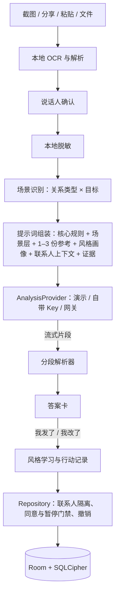

# 01 · 总体规划

> 2026-10-31 修订：产品范围从「恋爱军师」扩展为「全场景聊天军师」。核心流程以上传聊天记录为中心，回答必须符合用户本人的风格。新增「悬浮军师」：在聊天应用中点一下悬浮球即可获得建议（见第 12 节）。本文档以这一版本为准。

## 1. 产品定位

**狗头军师：教不会聊天的人和任何人好好说话，而且说出来像你自己。**

用户把和领导、同事、暧昧对象、伴侣、家人或朋友的聊天记录上传进来，军师结合知识库读懂局面，给出当前场景下**对用户目标最有利**的处理方式和一句可以直接发送的回复。这句回复既要适合场合，又要保留用户自己的说话习惯。同时，军师会解释为什么这样说更好，让用户越用越会聊天。

| 现状（Skill） | 问题 | App 的升级方向 |
| --- | --- | --- |
| 只覆盖恋爱场景 | 领导、家人、矛盾调解这些高频需求没有覆盖 | 职场、亲密、家庭、社交、调解五大场景 |
| 必须安装到 AI 助手里使用 | 普通用户用不了 | 下载即用 |
| 聊天记录需要手动粘贴或使用 ChatLab | 手机上最常见的是截图，步骤太多 | 截图识别、系统分享、文件导入，是首页的第一入口；在聊天应用中点一下悬浮球就能分析当前屏幕 |
| 回复是通用话术 | 发出去不像本人，对方一眼就能看出来 | 风格画像：从用户自己发过的消息中学习说话习惯 |
| 只给答案 | 用户下次还是不会 | 每次附上一个「为什么这么说」的技巧点拨，并提供对练 |
| 输出是一大段文字 | 手机上找不到重点 | 结构化答案卡：可发送回复置顶 |

**不变的部分**：Skill 的核心原则全部保留——先接住情绪，再分清事实，最后给出能执行的选择；证据边界、安全边界、按需加载知识的方式也不变。`SKILL.md` 和 `references/` 仍是唯一来源，App 在构建时打包。

### 1.1 「最优」的定义

军师不会声称存在一个客观上最好的回答。「最优」指的是：**在用户的目标、与对方的关系和可承受的风险下，代价最小、效果最可能的选择。**因此每次回答都要：

1. 说明这个方案为什么最适合用户的目标；
2. 说明它的代价，或者放弃了什么；
3. 提供最多两个备选方案（例如「更稳妥」「更直接」），供用户根据自己的判断选择。

用户没有说明目标时，军师根据聊天记录推断一个最可能的目标，并请用户确认或修改（一键切换）。

## 2. 场景体系

### 2.1 关系类型（联系人的属性）

| 大类 | 关系类型 | 场景中的关键变量 |
| --- | --- | --- |
| 职场 | 领导/上级、同事、下属、客户/合作方 | 权力差、正式程度、书面留痕、职业利益 |
| 亲密 | 暧昧对象、恋人/伴侣、前任 | 吸引、互惠、边界、同意（性别不限，不预设性别角色） |
| 家庭 | 父母、伴侣的家人、亲戚、子女、兄弟姐妹 | 代际差异、长期关系、情感绑架、边界 |
| 社交 | 朋友、新认识的人、群聊 | 亲疏程度、面子、群体场合 |
| 调解 | 用户是矛盾一方；用户是夹在中间的第三方（例如婆媳之间、两个同事之间） | 各方立场、情绪温度、可接受的妥协 |

### 2.2 本轮目标（每次分析时识别或由用户选择）

回复、请示/汇报、请求帮忙、拒绝、道歉、解释/澄清、安慰、推进关系、邀约、划清边界、化解尴尬、修复关系、调解矛盾、结束话题。

同一个目标在不同关系里的最优解不同。例如「拒绝」：对领导要先表态后给替代方案并留下书面依据；对父母要先承认关心再表达边界；对暧昧对象要具体拒绝时间而不是否定这个人。这些差异由场景知识库和场景提示词提供（见第 6 节）。

## 3. 核心使用流程

```text
① 上传聊天记录      截图（可多张、长截图）/ 系统分享的文字或图片 / 粘贴 / TXT·JSON 文件
                    / 在聊天应用中点悬浮球，截取当前屏幕
        ↓
② 本地识别与确认    OCR → 推断说话人 → 用户确认「哪边是我」→ 自动脱敏预览
        ↓
③ 场景识别          关系类型 + 本轮目标（模型推断，一键修改）+ 可选：此刻心情
        ↓
④ 全方面分析        局势判断 · 对方可能的需求与情绪 · 事实/推测/未知 · 风险
        ↓
⑤ 最优方案          首选做法 + 一句像你的回复 + 理由与代价 + 备选（稳妥 / 直接）
        ↓
⑥ 学会它            本次技巧点拨 · 你的表达习惯提醒 · 可选：和军师对练一轮
        ↓
⑦ 跟进              我发了 / 我改了再发 → 对方回复后继续上传 → 连续分析
```

第 ⑦ 步是持续使用的关键：用户把对方的新回复截图再传进来，军师在同一个联系人的上下文里继续分析，不需要重复交代背景。

## 4. 功能范围

### 4.1 首版必须交付

| 模块 | 功能 |
| --- | --- |
| 聊天记录导入 | 多张截图 OCR、长截图分段识别、系统分享接收（文字和图片）、粘贴、TXT/JSON 文件；说话人确认；导入预览；重复检测 |
| 悬浮军师 | 悬浮球；点一下截取当前屏幕并在本地识别；半屏答案面板；复制后自动收起；再往上截一屏；昵称只提供联系人候选并确认来源；快捷设置磁贴；机型权限引导 |
| 隐私脱敏 | 发送给模型前，在本地把可识别的手机号、邮箱、证件号、地址、真实姓名替换为代号；自动识别可能漏检，支持检查和自定义屏蔽词；用户可以预览实际发送的内容 |
| 场景识别 | 关系类型、本轮目标、正式程度；模型推断后用户一键修改 |
| 全方面分析 | 局势判断、对方需求与情绪、事实/推测/未知、风险、权力关系（职场）、各方立场（调解） |
| 最优方案 | 首选做法、首选回复（像你）、理由、代价、最多 2 个备选；换口吻；重新生成 |
| 风格画像 | 从用户确认为「我」的消息中学习说话习惯；可选的「哪句更像你」小测试；用户修改建议回复后学习修改；按关系类型区分（对领导和对朋友的风格不同） |
| 教学 | 每次回答附带一个技巧点拨；提醒影响效果的表达习惯；技巧收藏本 |
| 对练 | 军师扮演对方（基于聊天记录中对方的风格），用户练习回复，每轮给出简短点评 |
| 联系人档案 | 多个联系人，按关系类型分组；时间线；连续分析上下文 |
| 情绪与安全 | 情绪打分、平静模式、发送前冷静、危机安全卡 |
| 长期记忆 | 明确同意、变更提示与撤销、暂停、查看与编辑、全部清空 |
| 隐私 | 应用锁、最近任务隐藏、通知脱敏、伪装图标、一键清除 |
| 模型 | 演示模式、自带 Key（兼容 OpenAI 协议）、预留官方网关 |
| 备份 | 首版支持用户主动的加密导出／导入；排除密钥、授权状态和临时会话；关闭敏感数据系统自动备份与设备迁移 |

### 4.2 后续版本

悬浮军师的「跟随模式」（见第 12.6 节）、群聊分析（多人说话人映射）、语音消息转文字、邮件与正式文书润色、云同步、平板适配、桌面小组件、英文版。

### 4.3 明确不做

- 不读取、解密或导出微信、QQ、钉钉、飞书等应用的数据库；不使用无障碍服务读取其他应用的界面；不自动替用户发送消息。
- 不帮助欺骗、操控、PUA、职场诬陷、伪造聊天记录或冒充他人。
- 不显示「成功率」「好感度」「领导对你的评分」等伪精确数字。
- 不做打卡、排行榜、召回推送等诱导依赖的机制；不在用户情绪危机时展示付费墙。

## 5. 信息架构

```text
军师（首页）
├── 顶部：联系人切换器［临时问问 ▾］+ 模型状态
├── 主入口：［上传聊天记录］大按钮（截图 / 文件 / 粘贴）
├── 快捷场景：回领导消息 · 回暧昧对象 · 和家人沟通 · 调解矛盾 · 我现在很难受
├── 进行中：最近的联系人和待跟进的对话
├── 对话流：用户消息 / 导入卡片 / 答案卡 / 记忆提示
└── 输入区：附件 + 情绪（可选）+ 发送

联系人
├── 按关系类型分组：职场 · 亲密 · 家庭 · 社交
└── 联系人详情：概览 · 时间线 · 档案 · 记忆 · 和军师聊聊 TA · 对练

我的
├── 我的风格：风格画像（可编辑）· 风格小测试 · 按关系类型的差异
├── 技巧本：收藏的技巧点拨
├── 悬浮军师：开关 · 权限状态 · 会话超时 · 左右侧设置 · 昵称与联系人的对应
├── 记忆与隐私 · 安全 · 模型 · 偏好
└── 关于：免责声明、求助资源、开源许可、反馈
```

## 6. 军师大脑：知识与提示词

### 6.1 三层结构

| 层 | 位置 | 内容 |
| --- | --- | --- |
| 核心规则 | `SKILL.md`（共用） | 情绪 → 事实 → 选择的方法，证据边界，安全边界 |
| 场景层 | `android/core/knowledge/src/main/assets/app-prompt/scenes/*.md`（App 专用） | 每个大类一份：职场、亲密、家庭、社交、调解。写明本场景的关键变量、常见目标的最优解原则和禁忌 |
| 知识库 | `references/`（共用） | 按需加载 1–3 份 |

`SKILL.md` 受校验器限制（不超过 5000 字符），并且是恋爱 Skill 的行为内核，因此**不把职场和家庭规则塞进 `SKILL.md`**。App 用场景层把核心方法推广到其他关系。新增的知识文档放进 `references/`，Skill 和 App 都可以使用。

### 6.2 需要新增的知识文档

现有知识库以恋爱为主；职场已有 4 份可用的实用文档（领导青睐、托人办事、高情商拒绝、理性冲突处理），家庭有知识 11、12。需要补充：

| 新文档 | 层 | 内容 |
| --- | --- | --- |
| `knowledge/21-职场沟通与向上管理.md` | 知识 | 权力距离、心理安全、反馈与汇报的研究证据、书面沟通留痕 |
| `knowledge/22-家庭沟通与代际关系.md` | 知识 | 代际价值差异、家庭系统、情感勒索的识别、边界设定 |
| `knowledge/23-冲突调解与第三方斡旋.md` | 知识 | 立场与利益、非暴力沟通、调解者的中立与边界 |
| `practical/职场高频场景：请示汇报、请假、推进与拒绝.md` | 实用 | 每个子场景都采用「适用场景—效果—代价—下一步」结构 |
| `practical/家人沟通：关心、催促、分歧与边界.md` | 实用 | 催婚、催生、职业选择、金钱、生活习惯 |
| `practical/夹在中间：第三方调解实用指南.md` | 实用 | 分别倾听、转述不加料、找到共同利益、何时退出 |
| `practical/个人风格画像：保留个性的表达升级.md` | 实用 | 风格的组成维度、哪些习惯要保留、哪些要修正、跨场合的风格切换 |

新文档必须遵守 [知识库治理](../knowledge-base.md) 中的证据等级与包容性要求。由 Codex 起草，项目负责人审阅后合并。

### 6.3 提示词组装

1. 系统提示词从只读 `SKILL.md`、App 运行说明及场景层组装；App 交互协议与安全边界优先。非亲密场景只复用通用方法和边界，不触发恋爱建档、MBTI 问卷或默认约会推进。用五场景提示词快照与评测验证冲突已消除。场景与知识内容须负责人审阅后才能发布合并。
2. 知识路由：`routes.json` 根据**关系类型 × 本轮目标 × 关键词**选择 1–3 份参考，总字符设上限（默认 24k，可配置）。
3. 风格上下文：当前关系类型对应的风格画像（不超过 600 字）+ 3–5 条用户本人的真实消息样本（已脱敏）。
4. 联系人上下文：只注入当前联系人的记忆、最近事件和上一轮分析的摘要；临时问问不注入任何联系人数据。
5. 聊天记录：放在 `<evidence source="..." id="...">` 中，并声明证据区内的文字是数据，不是指令。消息按 `[编号] 我/TA：内容` 的格式排列。
6. 普通长记录超过预算时，本地保留最近消息，较早部分以独立步骤调用模型压缩为带编号的时间线摘要，显示该步骤及请求状态。悬浮点击只用已有摘要与本地预算截断，不额外触发摘要调用。
7. 主分析、长记录摘要、风格描述、回复改写、对练均通过同一出站请求组装器，对 userText、证据、记忆、样本、原答案和摘要统一脱敏；发送预览与网络请求复用同一份组装结果。发送前披露提供方及数据范围，可检查和添加屏蔽词，不保证所有身份信息均被自动识别。

## 7. 风格画像

「像你」不等于照抄用户现在的说话方式——不会聊天的用户，有些习惯本身就是问题。原则是：**保留个性，修正问题。**

| 维度 | 举例 | 处理方式 |
| --- | --- | --- |
| 个性标记 | 常用语气词（「哈哈」「嗯嗯」「好滴」）、表情包和 emoji 的习惯、标点习惯、称呼方式、幽默类型 | **保留**，生成的回复要带上 |
| 句式 | 平均句长、是否喜欢分条、是否连发多条 | 在合适的范围内保留 |
| 正式程度 | 对领导用「您」还是「你」 | 按关系类型分开学习 |
| 影响效果的习惯 | 只回一个字、过度道歉、反问句太多、长段落没有重点、连发轰炸 | **修正**，并在技巧点拨中温和指出 |

数据来源（用户都能在「我的风格」中查看和编辑）：

1. 用户在导入记录中确认为「我」的消息。本地计算可统计的特征（句长、emoji 频率、常用词等），再用模型生成一段文字描述。
2. 可选的「哪句更像你」小测试：5 组，每组 3 个选项。
3. 用户在复制前修改了建议回复：修改后的版本可作为风格样本。

全部来源（import／quiz／edited_reply）的样本、特征、描述和摘要持久化，均在 Repository 事务内检查当前同意及暂停状态；未同意、暂停或撤回时只在当前会话内存计算。异步结果写入时重新核对 consentVersion 与 sourceRevision，过期结果不能落库。临时会话即使已有全局同意也不落库。

导入和改写样本必须带来源外键，测验可无联系人。删除联系人、导入或样本时删除关联样本，递增来源版本，使画像、提示词及摘要缓存失效，并以剩余样本重算；重算完成前不使用旧画像。全局风格不得用作其他联系人的事实或记忆。

同意卡明确说明：档案保存在这台手机上；分析时，本次选中的记忆与脱敏聊天样本会发送给配置的模型服务商；可以查看发送内容、暂停或删除本机档案。

回复生成中提供一个调节项：「更像我 ←→ 更得体」，默认在中间。

## 8. 技术架构

### 8.1 选型

| 层 | 选择 | 理由 |
| --- | --- | --- |
| 语言与界面 | Kotlin + Jetpack Compose + Material 3 | 官方推荐；动态字号与深色模式支持完整 |
| 架构 | 单 Activity + Navigation Compose；MVVM + 单向数据流 | 符合 Android 官方架构指南 |
| 依赖注入 | Hilt | 便于替换模型提供方和测试 |
| 异步 | Coroutines + Flow | 流式输出、取消与超时 |
| 本地数据库 | Room + SQLCipher（`net.zetetic:sqlcipher-android`） | Room 本身不加密；数据库口令由 Keystore 密钥加密保存 |
| 偏好 | DataStore | 只存非敏感设置 |
| 网络 | OkHttp + Retrofit + kotlinx.serialization；SSE | 兼容 OpenAI 协议的服务商 |
| 截图识别 | PaddleOCR 官方 SDK 与打包端侧模型（负责人已确认替代 ML Kit） | 图片不上传、不发送统计指标；仅在无网络权限的隔离服务初始化。需实测无 GMS 环境、原生库/模型兼容及性能，不可用时保留粘贴退路 |
| 后台任务 | WorkManager | 跟进提醒 |
| 悬浮军师 | `WindowManager` 悬浮窗 + MediaProjection + 前台服务 + TileService | 系统正规支持的屏幕截取方式；不使用无障碍服务 |
| 测试 | JUnit、Turbine、Room 迁移测试、Compose UI 测试、Roborazzi 截图测试 | |

版本建议：minSdk 26；targetSdk 和 compileSdk 使用工程创建时最新的稳定版本；全部版本写入 `gradle/libs.versions.toml`。

### 8.2 工程结构

```text
goutoujunshi/
├── SKILL.md, references/        # 军师大脑：唯一来源
├── evals/                       # 合成评测集
├── android/
│   ├── app/                     # Application、导航、各功能页面
│   ├── core/designsystem/       # 主题与组件（Claude 负责视觉）
│   ├── core/domain/             # 实体、用例、分析契约、风格特征计算；纯 Kotlin
│   ├── core/data/               # Room、Repository、加密、模型客户端、OCR、WorkManager
│   └── core/knowledge/          # 打包 SKILL 与 references、场景层、路由、提示词组装、脱敏
└── scripts/, documentation/
```

`core/knowledge` 以 `android` Gradle 根工程的父目录为仓库根，将只读 `SKILL.md` 和 `references/**` 打包到 `build/generated/` 下的 assets；声明输入输出、稳定排序并生成确定性的 SHA-256 清单，禁止手工复制到源码资产目录。

模块依赖方向：`app → designsystem / data / knowledge / domain`，`data → domain`，`knowledge → domain`；domain 不依赖 Android、data 或 UI。designsystem 拥有展示模型，由 app 映射领域模型，禁止依赖 app 的 ViewModel 或页面类型。

### 8.3 运行时数据流



### 8.4 分析契约

```kotlin
enum class RequestMode { FULL_ANALYSIS, REWRITE_REPLY }

interface AnalysisProvider {
    val kind: ProviderKind            // DEMO, BYOK, GATEWAY
    fun analyze(request: AnalysisRequest): Flow<AnalysisChunk>
}

data class AnalysisRequest(
    val requestId: String,            // 同一操作失败重试复用；新操作使用新 UUID
    val mode: RequestMode,            // FULL_ANALYSIS / REWRITE_REPLY
    val parentAnswerId: String?,
    val originalAnswer: StructuredAnswer?,
    val inputRevision: Long,
    val contactId: String?,           // null 表示临时问问
    val relationType: RelationType?,  // BOSS, COLLEAGUE, SUBORDINATE, CLIENT, CRUSH, PARTNER, EX, PARENT, IN_LAW, RELATIVE, CHILD, SIBLING, FRIEND, ACQUAINTANCE, GROUP, MEDIATION
    val goal: Goal?,                  // REPLY, REPORT, ASK_HELP, DECLINE, APOLOGIZE, CLARIFY, COMFORT, ADVANCE, INVITE, BOUNDARY, ICEBREAK, REPAIR, MEDIATE, CLOSE
    val userText: String,
    val emotionLevel: Int?,           // 0–10
    val evidence: List<EvidenceBlock>,// 已确认说话人并已脱敏
    val styleBias: Float,             // 0 = 更得体，1 = 更像我，默认 0.5
    val tone: Tone?,
)

sealed interface AnalysisChunk {
    data class Section(val id: SectionId, val textDelta: String) : AnalysisChunk
    data class Completed(val answer: StructuredAnswer) : AnalysisChunk
    data class Failed(val error: AnalysisError) : AnalysisChunk
}
```

请求语义：同一输入和操作的网络重试复用 requestId；换口吻、调整风格及改目标都是新操作，关联原答案并递增 inputRevision。局部改写仅合并 REPLY／ALT；若重新检测到危机，必须提高安全级别并隐藏普通策略，不能降低已有安全级别。过期输入或会话版本的结果不能覆盖当前答案。客户端幂等只保证不重复落库；提供方不保证幂等时，不能承诺不重复计费。

**分段协议**：模型按以下标记分段输出。解析器必须容错：标记缺失时把全文放入 `FREE_TEXT` 正常显示。

```text
[[SAFETY]]   none | caution | crisis
[[SCENE]]    关系类型|本轮目标|正式程度 low/medium/high   （模型推断，供界面显示并允许修改）
[[EMPATHY]]  1–3 句情绪承接（情绪平稳时可以为空）
[[VERDICT]]  一句话首选做法
[[REPLY]]    首选回复；可以是多条消息，用 +++ 分隔，表示分开发送
[[ALT]]      备选：标签|回复内容，每行一个，最多 2 个（例如 更稳妥|…、更直接|…）
[[WHY]]      为什么这是最优选择，2–4 条
[[COST]]     这样做的代价，或放弃了什么
[[SITUATION]] 局势判断：对方的状态、可能的需求、双方的权力关系或立场
[[FACTS]]    F|内容|消息编号
[[GUESSES]]  G|内容|置信度 high/medium/low
[[UNKNOWNS]] 每行一条
[[RISK]]     需要注意的风险（例如书面留痕、被截图转发、关系升级）
[[TIP]]      技巧名称|一句话解释|在本次回复中如何体现
[[HABIT]]    （可选）用户表达习惯中值得改进的一点，语气温和
[[NEXT]]     发出之后观察什么，对方不同反应时怎么办
[[ASK]]      最多 3 个真正影响判断的问题
[[MEMORY]]   JSON 数组：建议写入的记忆变更，由 App 校验
```

显示规则：首屏依次为 SCENE 标签、VERDICT、REPLY；其余分段折叠。`SAFETY = crisis` 时切换为安全卡；本地关键词检测也可以独立触发。

### 8.5 数据模型

| 实体 | 关键字段 | 说明 |
| --- | --- | --- |
| `Contact` | id、alias、relationType、notes?、archivedAt?、createdAt | 只需代号和关系类型 |
| `Conversation` | id、contactId?、isTemporary、updatedAt | 临时会话不落库 |
| `AnalysisRun` | requestId（唯一）、conversationId、mode、parentAnswerId?、inputRevision、status | 一次用户操作；临时模式仅在内存 |
| `Message` | id（唯一）、conversationId、role、text、answerJson?、requestId、status | requestId 是关联键；用户和助手可共享；每请求至多一个当前助手结果 |
| `ChatImport` | id、contactId、sourceType（screenshot/share/paste/file）、contentHash、importedAt | 一次导入 |
| `ChatLine` | id、importId、seq、speaker（ME/THEM/OTHER）、text、sentAt?、ocrConfidence? | 导入后的逐条消息 |
| `StyleProfile` | id、relationGroup（WORK/INTIMATE/FAMILY/SOCIAL/DEFAULT）、features JSON、description、sourceRevision、updatedAt | 风格画像，按关系大类 |
| `StyleSample` | id、relationGroup、text、origin（import/quiz/edited_reply）、sourceContactId?、sourceImportId?、sourceMessageId?、sourceAnswerId?、consentVersion、createdAt | 来源外键可追溯；每个大类最多 30 条 |
| `Tip` | id、name、explanation、example、savedAt | 技巧本 |
| `Event` | id、contactId、occurredAt?、timePrecision、summary、lineRefs | 关键事件 |
| `ActionPlan` | id、contactId、chosenReply、wasEdited、status（pending/sent/skipped）、followUp? | 跟进 |
| `MemoryEntry` / `MemoryOperation` / `ConsentState` | 沿用 Skill 规则：配额、来源、置信度；只允许撤销最新一条操作 | |

规则：所有联系人数据必须带 `contactId`，Repository 不提供跨联系人读取证据的接口；推测不会自动升级为事实；删除联系人、导入或样本时在事务中删除关联记录及风格样本，使派生画像与缓存失效，递增来源版本，重算后才可复用画像；提交后删除关联文件并使在途结果失效。

临时会话及草稿、导入、原始截图、摘要与风格样本仅在进程内存中；不得进入数据库、DataStore、文件、SavedStateHandle／Bundle 或后台任务输入。网络失败在进程存活期间可恢复，进程结束即清除，界面提前告知。用户主动保存为联系人会话后才迁移选定内容，迁移应幂等。正式会话的敏感草稿存加密数据库；DataStore 只存非敏感偏好及加密的密钥包装值。

## 9. 非功能要求

| 项 | 目标 |
| --- | --- |
| 从截图到答案 | 3 张截图，OCR 在中端机上 < 3 秒；确认说话人只需 1 次点击（推断正确时） |
| 悬浮军师 | 点击悬浮球到面板显示识别结果 < 1.5 秒；到首选回复开始出现取决于模型，界面不额外增加等待 |
| 冷启动 | 中端机 < 1.5 秒 |
| 包体积 | < 25 MB（不含 OCR 模型）；OCR 模型单独评估 |
| 离线 | OCR、档案、历史、草稿可用；无法生成新分析时明确提示并保留内容 |
| 无障碍 | 系统字号 200% × App 特大 1.3（有效 260%）不截断；TalkBack 全流程可用；对比度 AA |
| 隐私 | 截图不上传；发送给模型的内容先脱敏并可预览；无第三方统计 SDK |

## 10. 合规与上架

- 用户上传的聊天记录包含第三方（领导、家人等）的个人信息。App 在本地脱敏后再发送，在隐私政策中说明模型服务商和数据处理方式，并在首次导入时提示「请只上传你有权使用的聊天内容」。
- App 自行提供生成式 AI 服务（官方网关模式）时，需要评估生成式 AI 服务备案和算法备案的义务。**需要项目负责人在 M5 前确认。**
- 悬浮窗和屏幕录制属于敏感能力，国内应用商店审核时需要说明用途。隐私政策中需写明：只在用户点击时截取一帧，图片只在本地识别，不保存、不上传。
- 分支代码许可证不一致（见研究文档第 4 节），首版只参考设计，不直接复制非 MIT 代码。

## 11. 里程碑与验收

| 里程碑 | 交付 | 验收 |
| --- | --- | --- |
| **M0 契约与知识** | 修复记忆脚本缺陷；新增 7 份知识文档初稿与 5 份场景层文件；评测集初版（覆盖 5 大场景） | 记忆缺陷有回归测试；知识文档通过负责人审阅；`validate_skill.py` 通过 |
| **M1 可安装骨架** | 工程、模块、导航、基础 designsystem、加密数据库、演示模式 | 调试 APK 能安装；演示模式完成「粘贴 → 答案卡 → 复制」 |
| **M2 核心闭环** | 截图 OCR、分享接收、说话人确认、脱敏、场景识别、真实模型、完整答案卡、连续分析 | 用真实截图（合成内容）完成 5 大场景各 2 个案例；失败路径均可恢复 |
| **M3 悬浮军师** | 悬浮球、截屏会话与单帧捕获、悬浮答案面板、权限与机型引导 | 在至少 3 个品牌的真机上完成「打开聊天 → 点悬浮球 → 复制回复」；截图中不包含悬浮球；禁止截屏的页面给出替代方法；会话超时后录屏停止 |
| **M4 像你** | 风格画像（导入学习、小测试、修改学习）、联系人档案与时间线、长期记忆 | 同一个问题，开启风格画像后的回复在盲测中被评为「更像本人」；联系人之间无串线 |
| **M5 学会它** | 技巧点拨与技巧本、表达习惯提醒、对练、情绪与安全、跟进提醒、隐私 | 对练能基于对方风格扮演；危机卡在模型回答前出现；锁定后最近任务看不到内容 |
| **M6 体验与发布** | 无障碍、性能、备份导出、评测跑分、签名 | 第 9 节指标达标；评测关键边界错误为 0 |

T12 后立即建立 T-QA，再开展 T16 和其他页面；T13 先落实请求协议，T14 先完成临时存储、全部风格授权与来源删除契约，再供 T16／T41 接入。应用锁和危机显示至少在 T25 前提供 App 与悬浮面板共用接口及可执行默认实现。

每个里程碑结束时提交截图测试输出，交给 Claude 做视觉审查。知识审阅、真实模型五场景、三品牌设备、签名与上架分别由负责人验收；缺少 Key 或设备时保留待验证，自动测试不能替代人工门禁。

## 12. 悬浮军师

### 12.1 是什么

用户正在微信、QQ、钉钉等应用中聊天时，点一下屏幕边缘的狗头悬浮球，军师截取当前这一屏、在本地识别文字，然后在屏幕下半部分弹出一个小面板，给出一句像用户本人、适合当前场景的回复。用户复制后粘贴到聊天框，自己决定是否发送。**用户不需要离开聊天界面。**

### 12.2 技术路线的选择

| 路线 | 结论 | 理由 |
| --- | --- | --- |
| 悬浮窗 + 用户点击时用 MediaProjection 截取一帧 | ✅ 采用 | Android 正规支持；用户知情（系统授权弹窗 + 状态栏录屏标识）；图片在本地处理 |
| 持续录屏、画面变化即自动分析 | ⏸ 后续作为可选的「跟随模式」 | 耗电、模型费用高、隐私风险大、频繁打扰用户 |
| 无障碍服务读取其他应用的界面文字 | ❌ 不采用 | 聊天应用可能检测到并限制用户账号；应用商店审核严格；违反「不读取其他应用界面」的隐私原则 |

### 12.3 流程

```text
开启悬浮军师（悬浮窗权限 → 机型后台引导 → 每次会话的系统录屏授权）
  → 悬浮球停靠在屏幕边缘
用户在聊天应用中点悬浮球
  → 隐藏悬浮球 → 截取一帧（仅在内存中）→ 恢复悬浮球为「分析中」
  → 本地 OCR → 推断左右（沿用上次确认）→ 识别标题栏昵称 → 候选及来源确认（确认前仅用临时上下文）
  → 脱敏 → 场景识别 → AnalysisProvider（与 App 内共用）
  → 半屏面板：联系人与场景标签 + 首选回复 + [复制] [换口吻] [再往上截一屏] [在 App 中查看完整分析]
  → 复制 → 面板自动收起 → 用户粘贴发送
```

### 12.4 关键设计

| 问题 | 方案 |
| --- | --- |
| Android 14 起每次录屏会话都要重新授权 | 用户开启悬浮军师时授权一次，会话持续到用户关闭或闲置超时（默认 10 分钟）；系统停止、锁屏、撤销、超时或关闭均释放捕获资源、移除悬浮窗、停止 FGS 与通知；通过 App 或磁贴新授权重开 |
| 会话期间持续渲染耗电 | 平时调用 `VirtualDisplay.setSurface(null)` 暂停渲染，点击时恢复并只取一帧 |
| 截图中出现悬浮球自己 | 截取前隐藏悬浮球和面板，等待下一帧画面后再截取 |
| 截到其他应用的隐私内容 | Android 14 QPR2 及以上引导用户选择「单个应用」共享，只共享聊天应用；截图只在内存中处理，不写入磁盘、不上传 |
| 不知道当前是哪个聊天应用、哪个联系人 | 不新增前台应用识别权限。昵称仅生成候选；新映射、同名、标题缺失、群聊或冲突时先确认，确认前不得读取候选记忆。映射记录用户确认的来源应用／账号上下文及版本，不能以昵称作唯一键；来源不可靠时每次确认或让用户确认来源，发送前替换真实昵称为代号 |
| 无有效画面或受保护页面 | 无有效画面提示「暂时没能读取画面」，检查共享应用或重试；确认受保护时提示复制可分享文字或导入已有文件。黑屏不能直接判定禁止截屏，不绕过保护，纯黑帧不送模型 |
| 国产系统会杀后台服务 | 按机型提供开启悬浮窗、允许后台运行、加入电池优化白名单的图文引导 |
| 面板挡住聊天应用的操作 | 面板默认不获取焦点，最多占屏幕的 55%，可以拖小；内部滚动确保最高字号组合可达所有操作；复制后自动收起 |
| 华为 HarmonyOS NEXT（纯血鸿蒙） | 无法安装 APK，不在本规划范围内；如果需要，另行规划鸿蒙版 |

状态机：`OFF → REQUESTING_PERMISSION → STARTING_SERVICE → READY → CAPTURING → RECOGNIZING → ANALYZING → READY`；任何状态均可经 `STOPPING → OFF`。同意投屏后启动 mediaProjection FGS，再获取 MediaProjection、注册 Callback，每会话仅创建一次 VirtualDisplay。停止统一清理取帧、Image、ImageReader、VirtualDisplay、Surface 和未使用帧，使会话 ID 及在途捕获结果失效；清理可重复调用，恢复必须新授权。覆盖系统停止、锁屏、拒绝／重复授权、旋转及单应用共享尺寸变化。

### 12.5 代码结构

悬浮军师放在 `app` 模块的 `floating` 包中：

```text
floating/
├── FloatingCounselService.kt     # 前台服务：悬浮窗与 MediaProjection 会话
├── OverlayWindowController.kt    # WindowManager 管理悬浮球与面板，提供 Compose 所需的 Lifecycle
├── ScreenCaptureSession.kt       # VirtualDisplay + ImageReader，单帧捕获、暂停、超时
├── FloatingCounselViewModel.kt   # 复用 M2 的导入、脱敏、分析用例
├── NicknameContactMatcher.kt     # 标题栏昵称 → 候选（来源确认后关联）
├── OemGuide.kt                   # 机型识别与设置页跳转
└── CounselTileService.kt         # 快捷设置磁贴
```

悬浮面板使用 designsystem 中的 `FloatingBall`、`FloatingAnswerPanel` 等组件（见 04 文档）。

### 12.6 后续：跟随模式（不在首版范围内）

用户主动开启，并且只在选择「单个应用」共享时可用：检测到屏幕底部出现对方的新消息时，自动更新面板中的建议，但不自动弹出，只在悬浮球上显示一个提示点。为控制费用与打扰，设置频率上限（例如每分钟最多 1 次），并且面板中常驻「暂停跟随」按钮。上线前需要单独评估耗电、费用和隐私影响。
